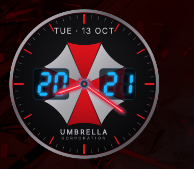

# Umbrella Clock

A desktop clock widget for [DankMaterialShell](https://github.com/AvengeMedia/DankMaterialShell), styled after the Umbrella Corporation from *Resident Evil*.



- Round dark dial with a metal bezel and 60 ticks (hour marks in red)
- Red-and-silver umbrella emblem in the centre (drawn as vectors; see below to use your own image)
- Hour and minute hands in neon scarlet — no second hand, so the widget repaints only once a minute
- Hours and minutes as cyan 7-segment digits with a neon glow
- Weekday and date above the emblem (Russian or English)
- Scales cleanly: the whole dial is drawn from a 380×380 design grid. Default size 300×300, minimum 160×160, always square

## Install

```sh
git clone https://github.com/Cha1000000/dms-umbrella-clock ~/.config/DankMaterialShell/plugins/umbrellaClock
```

Then enable **Umbrella Clock** in the DMS plugin settings and add it as a desktop widget. Move it with the **right mouse button**, resize by dragging the bottom-right corner. Position and size are remembered per monitor.

## Options

Set in the widget instance `config` (`~/.config/DankMaterialShell/settings.json` → `desktopWidgetInstances[].config`; edit it while DMS is stopped):

| Key | Default | Meaning |
|---|---|---|
| `handColor` | `#ff2438` | Hands and centre cap colour |
| `handCore` | `#ffd2d6` | Light core line inside the hands |
| `digitColor` | `#19b5ff` | Digit colour |
| `textColor` | `#d9d9de` | Weekday and date text colour |
| `brandColor` | `#b9b9c2` | UMBRELLA caption colour (CORPORATION is a darker shade of it) |
| `dateLanguage` | `auto` | `auto` (Russian with a `ru` locale, otherwise English), `ru` or `en` |

## Using your own emblem

The emblem is drawn with vector shapes. If a file named `umbrella-logo.png` (square, transparent background, emblem filling the image) is placed next to `UmbrellaClock.qml`, it is shown instead. The image is not shipped with this repository.

## Notes

"Umbrella Corporation" and its emblem belong to Capcom. This is an unofficial fan project and is not affiliated with Capcom. Part of the code was written with the help of an AI assistant (Claude Code) and reviewed and tested by the author.

## License

MIT
